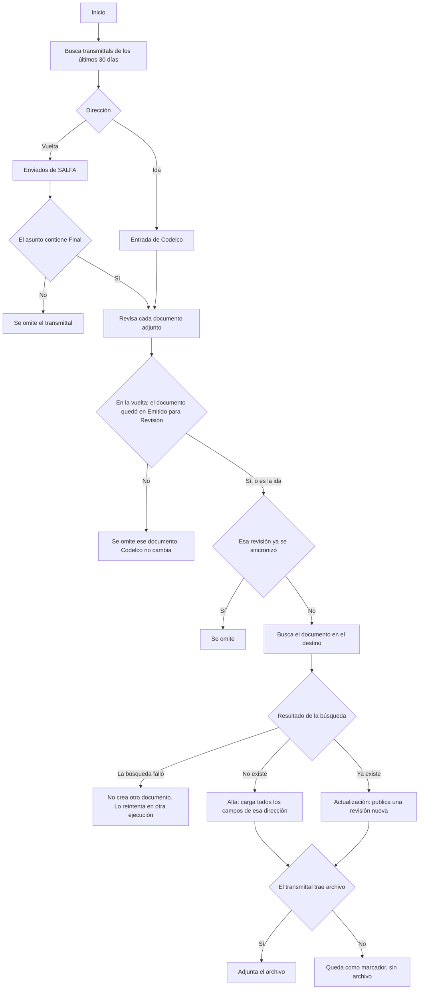

# Sincronización de transmittals

La sincronización no copia el correo. Lee el transmittal, toma cada documento adjunto y lo crea o lo actualiza en el registro del otro proyecto.

Cada ejecución mira los últimos **30 días**. Un transmittal ya sincronizado no se vuelve a escribir. La misma revisión de un documento tampoco se vuelve a enviar.

Hay dos momentos distintos, y no usan los mismos campos:

- **Alta.** El documento todavía no existe en el destino. Se cargan todos los campos de la dirección.
- **Actualización.** El documento ya existe. Se publica una revisión nueva y solo cambian la revisión, el estado, la fecha de revisión y el archivo. El resto queda como ya estaba en el destino.

Esto vale igual en la ida y en la vuelta.

## Cómo decide el proceso

Lectura corta del mismo recorrido:

1. Ida: bandeja de entrada de Codelco.
2. Vuelta: bandeja de enviados de SALFA. El asunto tiene que contener **Final**. El documento, al cerrar el flujo de trabajo, tiene que quedar en **Emitido para Revisión**.
3. Si esa revisión de ese documento ya se sincronizó, no se toca.
4. Se busca el documento en el destino.
5. Si no está, es un alta y se usan las tablas de creación.
6. Si está, es una actualización y solo cambian los cuatro datos de la sección siguiente.
7. Si el adjunto no trae archivo, el alta o la revisión queda sin archivo. Eso es un marcador.

En la ida, SALFA se busca con el número de Codelco guardado en **Código Codelco** y con el número que Aconex ya asignó. En la vuelta, Codelco se busca con ese mismo **Código Codelco**. Si en la vuelta ese campo está vacío, no hay número de destino y no se crea otro documento.

El estado que se escribe en Codelco es el que trae el documento. No se reemplaza por otro. Como la vuelta solo deja pasar **Emitido para Revisión**, ese es el estado que llega.

Si el flujo cierra en otro estado, el documento se omite. Codelco no se crea ni se actualiza. Pasa, por ejemplo, con **Rechazado** y con **Rechazado Control de Documentos**. Ese transmittal queda marcado como ya revisado: una ejecución posterior no lo vuelve a tomar. Para llevar ese resultado a Codelco hay que emitir otro transmittal.

## Qué se actualiza si el documento ya existe

Igual en Codelco y en SALFA. Del documento de origen solo entran estos datos:

| Qué cambia en el destino | De dónde sale | Identificador |
|---|---|---|
| Revisión | Revisión del adjunto del transmittal | `Revision` |
| Estado | Estado del documento de origen, traducido con EstatusDocumentos | En SALFA `DocumentStatusId`. En Codelco `statusid` |
| Fecha de revisión | Fecha de revisión del documento de origen. En la ida, si viene vacía, se usa la fecha de hoy | En SALFA `RevisionDate`. En Codelco `revisiondate` |
| Archivo | El archivo del transmittal. Si no hay archivo, la revisión queda sin archivo | `HasFile` |

No se reemplazan el número, el título, el autor, el tipo ni el resto de listas. Esos valores se leen del documento que ya está en el destino y se reenvían iguales, para que la revisión nueva no los borre.

En Codelco, estos campos se conservan siempre en una actualización. No vienen de SALFA:

| Campo que se conserva | Identificador |
|---|---|
| Emisor de origen | `Emisororigen_singleSelect` |
| Especialidad | `Especialidad_singleSelect` |
| Fase | `Fase_singleSelect` |
| Localizador | `Localizador_singleSelect` |
| Nro. de contrato | `NroDeContrato_singleSelect` |
| Proveedor | `Proveedor_singleSelect` |
| Rendición | `Rendicin_singleSelect` |
| Tipo de documento | `TipoDeDocumento_singleSelect` |

## Creación en la ida: Codelco → SALFA

Se usa solo cuando el documento todavía no existe en SALFA.

El número de SALFA lo asigna Aconex. El número de Codelco queda en **Código Codelco**, para encontrar el mismo documento en la vuelta.

| Campo en SALFA | De dónde sale | Identificador |
|---|---|---|
| Número de documento | Lo asigna Aconex. No se envía un número | `AutoNumber` |
| Título | Título del documento en Codelco | `Title` ← `title` |
| Revisión | Revisión del adjunto | `Revision` ← adjunto |
| Tipo de documento | Tipo de Codelco, traducido con TiposDocumentos | `DocumentTypeId` |
| Estado | Estado de Codelco, traducido con EstatusDocumentos | `DocumentStatusId` ← `statusid` |
| Autor | Autor en Codelco | `Author` ← `author` |
| Fecha de revisión | Fecha de revisión en Codelco. Si viene vacía, la fecha de hoy | `RevisionDate` ← `revisiondate` |
| Estado de revisión | Estado de revisión en Codelco | `ReviewStatusId` ← `reviewstatus` |
| CWA | Localizador de Codelco, traducido con EquivalenciaCwa. Si no hay valor, General | `Cwa_singleSelect` ← `Localizador_singleSelect` |
| Disciplina | Especialidad de Codelco, traducida con EquivalenciaDiscipline. Si no hay valor, General | `Discipline_singleSelect` ← `Especialidad_singleSelect` |
| Tipo de documento (lista) | Tipo de documento de Codelco, traducido con EquivalenciaTipoDocumento | `TipoDeDocumento_singleSelect` |
| Código Codelco | Número de documento en Codelco | `CdigoCodelco_singleLineText` ← `DocumentNumber` |
| N° de documento 3 | Número del transmittal | `NDeDocumento3_singleLineText` ← número del correo |
| CMA | Valor fijo TBD | `Cma_singleSelect` |
| Estado de control Red Line | Valor fijo TBD | `EstadoDeControlRedLine_singleSelect` |
| Estado de cubicación | Valor fijo TBD | `EstadoDeCubicacin_singleSelect` |
| Estatus BIM | Valor fijo TBD | `EstatusBim_singleSelect` |
| Entidad | Valor fijo TBD | `Entidad_singleSelect` |
| Estado de completitud | Valor fijo TBD | `EstadoDeCompletitud_singleSelect` |
| Estado de gestión del cambio | Valor fijo TBD | `EstadoDeGestinDelCambio_singleSelect` |
| Estado de consistencia | Valor fijo TBD | `EstadoDeConsistencia_singleSelect` |
| Proceso | Valor fijo Ingenieria | `Proceso_singleSelect` |
| Origen | Valor fijo Externo | `Origen_singleSelect` |
| Archivo | Archivo del transmittal, o sin archivo si es marcador | archivo del adjunto |

## Creación en la vuelta: SALFA → Codelco

Se usa solo cuando el documento todavía no existe en Codelco. En el flujo normal ya existe, porque nació en Codelco, y entonces aplica la sección de actualización.

| Campo en Codelco | De dónde sale | Identificador |
|---|---|---|
| Número de documento | Código Codelco guardado en SALFA | `DocumentNumber` ← `CdigoCodelco_singleLineText` |
| Título | Título en SALFA | `Title` |
| Revisión | Revisión del adjunto | `Revision` ← adjunto |
| Tipo de documento | Tipo interno de SALFA, traducido con TiposDocumentos | `doctype` ← `DocumentTypeId` |
| Estado | Estado del adjunto, traducido con EstatusDocumentos | `statusid` ← estado del adjunto |
| Autor | Autor en SALFA | `author` ← `Author` |
| Fecha de revisión | Fecha de revisión en SALFA | `revisiondate` ← `RevisionDate` |
| Archivo | Archivo del transmittal, o sin archivo si es marcador | archivo del adjunto |

Los campos de la tabla “qué se conserva” no se llenan desde SALFA en el alta. Solo se reenvían cuando el documento de Codelco ya existe.
